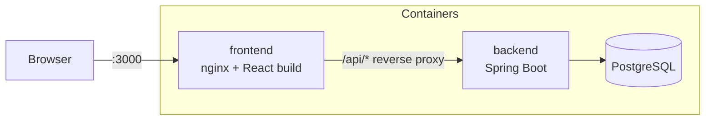

# Task Manager

[](https://github.com/turkermenes/taskmanager/actions/workflows/ci.yml)

A full-stack task management application built with **Spring Boot** and **React**.
Users can register, log in and manage their own tasks. The project focuses on
production-grade backend practices: layered architecture, JWT security,
database migrations, automated testing, containerization and CI.

## Features

- User registration and login with JWT authentication
- Create, list, update and delete personal tasks
- Strict ownership: users can only see and modify their own tasks
- Standardized error responses (RFC 9457 Problem Details) with field-level validation errors
- Interactive API documentation (OpenAPI / Swagger UI)
- Health checks with liveness and readiness probes

## Tech Stack

| Layer | Technologies |
|---|---|
| Backend | Java 21, Spring Boot 4, Spring Web MVC, Spring Data JPA (Hibernate), Spring Security (OAuth2 Resource Server, JWT), Bean Validation |
| Database | PostgreSQL 17, Flyway |
| Frontend | React, TypeScript, Vite, React Router |
| Testing | JUnit 5, Mockito, AssertJ, MockMvc, Testcontainers, JaCoCo |
| DevOps | Docker/Podman (multi-stage builds), Compose, nginx, GitHub Actions |
| Docs & Ops | springdoc-openapi, Spring Boot Actuator |

## Architecture



The backend follows a layered architecture:

```
Controller  →  Service  →  Repository  →  Database
   (HTTP)      (business     (data
               rules)        access)
```

DTOs are used at the API boundary; JPA entities are never exposed to clients.

## Getting Started

### Prerequisites

- Docker with Docker Compose, **or** Podman with podman-compose
- For local development: JDK 21+ and Node.js 20.19+

### Run the whole stack

```bash
cp .env.example .env
# Generate a signing key and put it into .env as JWT_SECRET
openssl rand -base64 32

docker compose up -d --build      # or: podman-compose up -d --build
```

| URL | Description |
|---|---|
| http://localhost:3000 | Web application |
| http://localhost:8080/swagger-ui.html | API documentation |
| http://localhost:8080/actuator/health | Health check |

### Local development

```bash
# 1. Start only the database
docker compose up -d postgres

# 2. Backend (dev profile is active by default)
cd backend
./mvnw spring-boot:run

# 3. Frontend (in another terminal)
cd frontend
npm install
npm run dev        # http://localhost:5173
```

## API Overview

| Method | Endpoint | Auth | Description |
|---|---|---|---|
| POST | `/api/v1/auth/register` | – | Register a new user |
| POST | `/api/v1/auth/login` | – | Log in and receive a JWT |
| GET | `/api/v1/users/me` | ✓ | Current user info |
| GET | `/api/v1/tasks` | ✓ | List own tasks (newest first) |
| POST | `/api/v1/tasks` | ✓ | Create a task |
| GET | `/api/v1/tasks/{id}` | ✓ | Get a task |
| PUT | `/api/v1/tasks/{id}` | ✓ | Update a task |
| DELETE | `/api/v1/tasks/{id}` | ✓ | Delete a task |

Full, interactive documentation is available in Swagger UI.

## Testing

```bash
cd backend
./mvnw verify       # unit, web-layer and integration tests + coverage check
```

- **Unit tests** cover service logic with Mockito.
- **Web layer tests** (`@WebMvcTest`) verify routing, validation, security rules and error responses.
- **Integration tests** run the full application against a real PostgreSQL instance via **Testcontainers**.
- **JaCoCo** enforces a minimum line coverage of 70% in CI.

Integration tests require a running Docker or Podman socket.

## Design Decisions

- **Stateless JWT authentication** using Spring Security's OAuth2 Resource Server
  instead of a hand-written filter. The same setup works with external identity
  providers such as Keycloak.
- **Ownership returns 404, not 403.** Accessing another user's task responds as
  "not found" to avoid revealing which resources exist (resource enumeration).
- **Ambiguous login errors.** Wrong username and wrong password return the same
  message to prevent user enumeration.
- **Database schema managed by Flyway**; Hibernate only validates (`ddl-auto: validate`).
- **Fail-fast configuration.** Required secrets are validated at startup; the
  application refuses to start with a missing or weak JWT secret.
- **Production-like tests** with Testcontainers instead of an in-memory database.
- **Secure containers**: multi-stage builds, layered JARs and non-root users.
- **Same-origin deployment** through an nginx reverse proxy, so no CORS is needed
  in production; CORS is configured per environment for local development.

## Project Structure

```
taskmanager/
├── backend/            Spring Boot application
├── frontend/           React + TypeScript application
├── compose.yaml        Local stack (PostgreSQL, backend, frontend)
├── .env.example        Required environment variables
└── .github/workflows/  CI pipeline
```

## Roadmap

- `PATCH /api/v1/tasks/{id}/status` for partial updates
- Refresh tokens and token revocation
- Pagination and server-side filtering for task lists
- Time-zone aware timestamps (`Instant` / `OffsetDateTime`)
- Constant-time login checks against timing attacks
- Data fetching with TanStack Query on the frontend
- Publishing container images to a registry (continuous delivery)